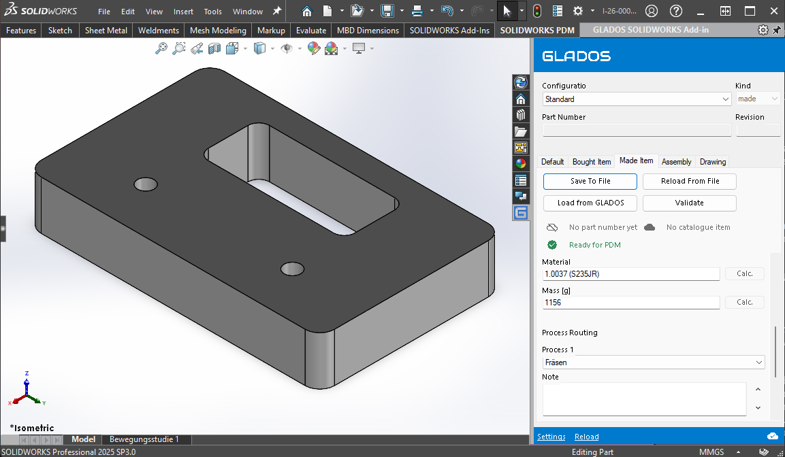

# GLADOS SOLIDWORKS Add-in

A task pane for SOLIDWORKS that connects parts and assemblies to the GLADOS catalogue. It shows
whether the open file matches its catalogue item, lets you edit the custom properties GLADOS
needs, and checks the file before it is released to SOLIDWORKS PDM.



## Features

- Matches the open file to a bought or made catalogue item by its PDM part number and shows
  whether the two agree.
- Edits the GLADOS properties of bought items, made items (including the process routing),
  customer items and made assemblies.
- Checks a file against the GLADOS ingest rules before release and warns about references into
  a Downloads folder.
- Fills a bought item from the EPLAN Data Portal, if the server has it enabled.
- Works offline from a cached copy of the lookup lists and the field mapping.
- English and German user interface.

Everything the add-in edits is written to the SOLIDWORKS file. Catalogue items are created by
the PDM ingest when the file is released, never by the add-in. The one exception is creating a
missing source item from the made item's source picker. See [docs/DESIGN.md](docs/DESIGN.md)
for the details.

## Requirements

- 64-bit Windows with SOLIDWORKS 2025 or later
- .NET Framework 4.8
- A GLADOS server (backend 0.1.x) and a personal access token. The SolidWorks add-in token
  preset in GLADOS has all the permissions the add-in uses.

## Installation

1. Download `GladosSwAddin-X.Y.Z.msi` from [Releases](../../releases) and run it. It needs
   admin rights and installs to `Program Files\DELOARTS\GLADOS SOLIDWORKS Add-in`.
2. Start SOLIDWORKS and open the GLADOS task pane.
3. Click **Settings**, enter the server URL and your personal access token, and test the
   credentials.

The installer enables the add-in at startup for the user who installed it. Other users on the
same machine can enable it under **Tools > Add-Ins**. To upgrade, run the newer MSI.
Downgrades are blocked. See [docs/RELEASE.md](docs/RELEASE.md) for uninstalling and the
SmartScreen warning on the unsigned installer.

If something goes wrong, **Settings > Open log folder** opens the daily logs. Attach the file
of the day to a bug report.

## Building

Use the full Visual Studio MSBuild. `dotnet build` can't build the classic .NET Framework
WinForms project.

```powershell
# Add-in (Debug builds also register the DLL for COM, which needs an elevated shell)
MSBuild.exe GladosSwAddin\GladosSwAddin.csproj /t:Build /p:Configuration=Debug

# Unit tests
MSBuild.exe GladosSwAddin.Tests\GladosSwAddin.Tests.csproj -restore /p:Configuration=Release
dotnet test GladosSwAddin.Tests\bin\Release\net48\GladosSwAddin.Tests.dll

# MSI installer (builds the add-in in Release first)
MSBuild.exe GladosSwAddin.Installer\GladosSwAddin.Installer.wixproj -restore /p:Configuration=Release
```

To register a DLL you didn't just build, run `regasm /codebase GladosSwAddin.dll` from an
elevated shell.

## Documentation

- [docs/DESIGN.md](docs/DESIGN.md): sync strategy, custom properties, write scopes,
  validation, lookup cache and logging
- [docs/FIELD_OWNERSHIP.md](docs/FIELD_OWNERSHIP.md): which system owns which field
- [docs/RELEASE.md](docs/RELEASE.md): versioning, release flow, install and upgrade
- [CHANGELOG.md](CHANGELOG.md)
- [SECURITY.md](SECURITY.md)

## License

glados-sw-addin is source-available under the [DELOARTS License (DAL) 1.0.0](LICENSE.md). You may use, change and share it for noncommercial purposes: personal use, research and study, and use by charitable, educational, public research and government organizations. Any commercial use, including using it inside a business, needs a separate commercial license from license@deloarts.com.

Third-party components bundled with glados-sw-addin remain under their own licenses.
