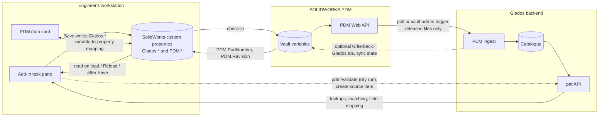

# GLADOS SOLIDWORKS Add-in

## Installation

Download `GladosSwAddin-X.Y.Z.msi` from this repo's
[Releases](../../releases) page and run it (admin rights required — it installs
per-machine, under `Program Files\DELOARTS\GLADOS SOLIDWORKS Add-in`). It registers the add-in with
SOLIDWORKS and sets it to load at startup **for the installing user only**; another Windows
user on the same machine who wants it loaded automatically either runs the installer
themselves or enables it per-user via SOLIDWORKS' own Tools > Add-Ins dialog. Upgrading is the
same MSI over an existing install; downgrading (an older MSI over a newer install) is blocked.
See [docs/RELEASE.md](docs/RELEASE.md) for what a release contains, what uninstalling leaves
behind, and the current unsigned-installer/SmartScreen caveat.

Developers who want a manual, non-MSI setup instead (e.g. to point SOLIDWORKS at a local
Debug build) can register the built `GladosSwAddin.dll` directly with `regasm /codebase`
from an elevated shell — this is exactly what `RegisterForComInterop` already does for Debug
builds from Visual Studio/MSBuild (see `CLAUDE.md`'s "Commands"), so it's rarely needed by
hand except when registering a DLL that wasn't just built locally.

## Sync strategy

### The invariant

**The add-in never writes to Glados.** It does not create catalogue items, does
not push field values, and does not assert links. Every write it performs goes
to the SolidWorks document; every call it makes to Glados is a read.

One documented exception: the made-item source-item picker's "Create Source
Item" panel can create a source item in the catalogue, gated by the same
`write:source_items` permission the web UI's own create form requires. It is
still a plain catalogue write, not a link — the add-in never asserts anything
beyond the explicit pick, and creates or edits no other catalogue entity. Its
dimension row mirrors the web's Block/Profile/Turned Part/Tube/Custom shape
presets (`Helpers/DimensionSpec.cs`) and prefills from the made item's current
material and base size, so a spec close to what's already on the part is a
few edits away rather than a blank form.

Items enter the catalogue from PDM, which is the owner of item identity. That
ingest path is outside this add-in. Keeping the invariant is what makes it
possible to say which system is right when the two disagree — an add-in that
could create items would produce ghost records that collide when PDM later
pushes the real one.

The consequence for the UI: the add-in reports, it does not reconcile. There is
no "push to Glados" action, and `Load from Glados` populates the task pane only —
the values are not written to the document until the user presses Save. `Reload
from file` therefore reverts to what is actually on the file, not to what was
loaded.
Save itself re-reads the file once the write is done, so calculated values (mass,
material, base size) show what SolidWorks now holds - see "Write scopes and
timing" below.

### Data flow



Item data takes exactly one route from the add-in to Glados: the add-in writes
the document's custom properties, PDM maps those properties to data card
variables, and ingest reads the variables through the PDM Web API once the file
is released (see `glados/docs/PDM_INTEGRATION.md`). The direct `pat` calls are
reads, plus the advisory validation and the source-item exception above.

The data card is a second writer of the same properties: a value edited on the
card lands in the same `Glados.*` property the add-in writes, and neither side
is notified of the other. The same goes for a value typed into File >
Properties, a macro, or PDM assigning a part number to an open file.

The task pane therefore watches the document itself: about every two seconds
the document watchdog compares a fingerprint of every property the pane reads
(raw values, both document level and the active configuration, so a linked
mass recalculating on rebuild is not a change) against the one taken at the
last load. On a difference, a pane without unsaved edits simply reloads, as if
Reload from file had been pressed; a pane with unsaved edits keeps them and
colours the Reload From File button orange instead, its tooltip saying why. The
check sits out the add-in's own Save and Calc. writes and any of its open
dialogs. It is a poll rather than SolidWorks' custom-property notifications,
which are not guaranteed for every writer.

Save therefore never writes the pane as it stands. Right before writing, it
re-reads the document and puts the user's edits on top of the file as it is
now (`SaveMergeService`), judging each field against the value the pane
loaded:

| Pane since load | File since load | Save writes |
| --- | --- | --- |
| unchanged | unchanged | the value, as before |
| unchanged | changed | the file's value — the outside change is kept |
| edited | unchanged | the user's edit |
| edited | changed to the same value | that value |
| edited | changed to a different value | asks: keep the user's values, keep the file's, or cancel the Save |

"Edited" uses the same comparison as the field's dirty marker. Labels are not
compared; they follow their key and are re-resolved as on every Save. Mass,
material and base size keep their own rule (written only on an explicit
override, see "Linked expressions on Save"): an outside change to them is kept
unless the user overrides, and an override wins without asking, since their
resolved value moves with every rebuild and a recalculation cannot be told
apart from an edit. A routing that has become unreadable in the file since
load is left as it is unless the user edits the routing.

### Taking a part from the EPLAN Data Portal

When Glados has the EPLAN Data Portal switched on, the bought tab can fill
itself from a manufacturer part. Leaving Order Code 1 runs an exact match in
the background, like the possible-duplicate check; a hit shows
"Found in the EPLAN Data Portal" next to the field. That link, or the Portal
button beside the field, opens the Data Portal dialog: the parts the order
code names (the portal's ranked search when it names none), each with its
picture and the catalogue item that already describes it, if any.

The dialog compares the part with the tab field by field. Fields that are
still empty are ticked, fields the engineer already filled are offered but
left alone, and article groups are added rather than replaced. Take
selected fills the tab as unsaved edits, the same as `Load from Glados`, and
records the part in `Glados.EdpPartId`; Save writes them to the file.

This keeps the invariant: every call is a read, and the catalogue item still comes from PDM. Ingest reads `Glados.EdpPartId`, links the item to the part and fetches its picture. The lookup needs a working connection and the `use:data_portal` permission on the token itself, since every call spends the organisation's Data Portal token. The SolidWorks add-in token preset in Glados includes it. A PAT only carries the permissions it was created with, so an older token needs replacing even when its owner holds the permission. The Portal button is hidden until the server reports the portal as switched on with a token; why it stayed hidden is in the add-in log. Mass, tariff number and a STEP model are not in the portal and still come from the engineer.

### Kind decides which catalogue

Which catalogue a document belongs to — Bought Item or Made Item — is
`Glados.Kind` (`made` or `bought`). Unlike every other add-in-written
property it is write-once: the first Save on either tab stamps it, and from
that point on the Source dropdown that switches between the two tabs is
locked to match it and can't be changed. A conflicting write (the property
already holding the *other* valid value) is refused rather than applied — see
`WriteKind` in `Services/SwCustomPropertyService.cs`.

This is what keeps tier 1/tier 2 matching below from ever running a document
against the wrong catalogue: once a document's kind is locked, the dropdown
that decides which tab (and which sync service, `BoughtItemSyncService` or
`MadeItemSyncService`) loads can no longer be changed to the other one, so
there is no path left that could look a bought document up as a made item or
vice versa.

### Customer items

A customer item is a made part received from a customer, usually a SOLIDWORKS
file pointing to the customer's STEP model through 3D Interconnect. It is no
third kind: `Glados.Kind` stays `made`, and a made part counts as a customer
item once `Glados.CustomerId` holds a customer.

The customer fields (Customer, Customer Part Number, Customer Revision) sit on
the Made Item tab under the article name, and its Save To File writes them with
the other made-item fields. They show only for a customer item: a file that
already holds customer data, or one started with the Default tab's *Create
CUSTOMER item* button, which picks `made` exactly like *Create MADE item* and
then shows them. A made assembly never shows them. Turning an existing made
item into a customer item is not supported in the add-in.

On *Create CUSTOMER item* the customer is pre-selected from the file's path when
a folder name equals a customer's name, ignoring case and extra spaces. The
folder closest to the file wins; archived customers and a name two customers
share never match, and a never saved file has no path to match. The pick is
only a suggestion until the first Save writes it.

The customer picker reads the customers in the lookup snapshot (id, name and
archived flag only). The tab marks the customer part number required once a
customer is picked, and the customer required once a part number or revision is
filled in. Like every other marker this is advisory: PDM ingest stores what the
file holds.

### Bought assemblies in a parent BOM

A bought assembly is one purchased item, so a parent assembly's BOM should list
it as a single row, not its internals. Every Save on the Bought tab of an
`.sldasm` therefore also sets each configuration's *Child component display when
used as a subassembly* (Configuration Properties → Bill of Materials Options) to
**Hide** — re-applied on every Save, so a manual change back to Show or Promote
lasts only until the next one. It's a configuration setting, not a custom
property, so the field mapping doesn't govern it. See
`WriteHideChildComponentsInBom` in `Services/SwCustomPropertyService.cs`.

### Imported bought assemblies that move

A downloaded STEP assembly inserted through 3D Interconnect is a rigid
subassembly, and once its link is broken its components only exist in memory, so
SolidWorks' own Make Virtual refuses them ("cannot locate the file"). On a bought
`.sldasm` the Bought tab therefore shows **Embed Imported Components**, which runs
the manual workaround in one go (`Services/ImportedComponentsService.cs`):

1. rebuild the assembly and, if it has unsaved changes, save it — Break Link fails
   on an assembly whose latest state isn't on disk, and the saved file is then the
   state to go back to;
2. break the link of every 3D Interconnect component that is an assembly (an
   imported part is left alone). This renames the imported components, so from here
   on they are told apart from the assembly's other components by elimination, not
   by name;
3. save each of its documents, children first, into a fresh work folder under
   `%TEMP%\GladosSwAddin\ImportedComponents\`;
4. dissolve the imported subassembly;
5. make the components it leaves behind virtual, so they live inside the bought
   assembly's file and nothing else lands in the vault;
6. rename them back from the "Copy of …" name SolidWorks gives a virtual copy.
   SolidWorks refuses a rename while *Update component names when documents are
   replaced* is on, so the option is switched off for the rename and restored
   afterwards. A name that can't be restored is only written to the log.

Breaking the link also means PDM no longer counts the imported file (the STEP) as a
reference of the assembly, so checking the assembly in would leave the STEP checked
out. The run therefore checks it in itself once the link is broken — even if a later
step fails — with a version comment naming the assembly
(`Services/PdmCheckInService.cs`). This is the add-in's only PDM action; it writes no
data-card variable. It goes through the PDM client installed on the machine: the
client's own interop assembly is loaded at runtime, so the build doesn't depend on a
PDM installation, and called through its typed interfaces (the client's late-bound
IDispatch rejects the check-in call). It logs in as whoever is logged in to the vault
in File Explorer. A file outside every
vault or already checked in is left alone; one PDM refuses, or one lying in a vault
folder without having been added, is listed in the closing message to check in by
hand.

The result is never saved: the assembly is left modified so the engineer floats the
moving parts, adds the mates and saves (or closes without saving to get back to the
state saved in step 1 — the broken link can't be undone any other way). If that
first save fails, nothing has changed and the add-in says so. For the same reason a
run's work folder isn't deleted straight away; the add-in deletes work folders
older than a day when it starts. A read-only (not checked-out) assembly is refused
before anything changes. The button shows for every bought assembly, since
inserting a STEP doesn't reload the pane; on one with nothing left to embed the
click just says so.

### Made assemblies

A made `.sldasm` (`Glados.Kind` = `made`) is not a Glados catalogue item and is
never ingested — the backend's made-item extensions are `.sldprt` only. The
Assembly tab therefore has no Load from Glados, no lookup/sync indicators and no
PDM validation. It edits Assembly Name (`Glados.ArticleName`), General Note
(`Glados.Note`) and the routing (`Glados.Processes` plus its process-names
label). A file that has never stored a routing starts from one fabrication step
with the method the backend flags as default for assemblies
(`default_for_assemblies`, delivered in the `GET pat/lookups` snapshot); that
step lives in the UI only until Save. A routing saved empty stays empty.

### Matching a document to a catalogue item

In tiers, decreasing confidence. The tier that matched is surfaced, because
"this *is* that item" and "this *might be* that item" are different claims:

1. **`PDM.PartNumber`** — the normal path, an exact lookup.
2. **Manufacturer + `OrderCode1`**, among items that have no part number
   assigned yet, and only when exactly one candidate matches. This is the case
   where the part was created in Glados before PDM numbered it. An ambiguous
   match is not reported at all — a wrong link is worse than no link.

Nothing is ever bound automatically. The tier-2 match is informational.

The catalogue also reports its own `part_number_duplicate` flag on every bought
item ("another non-archived item shares this part number"). That is a different
signal from tier 2 — it is about duplicates *inside* the catalogue, not about
matching this file to a row — and the add-in does not fold it into
`PossibleDuplicate`.

### States

Item lifecycle and sync state are independent, and are shown as separate
indicators. Collapsing them into one status loses information:

| Sync state | Meaning |
| --- | --- |
| `NoPartNumber` | Not published to PDM yet. Nothing to compare — this is normal, not an error. |
| `NotFound` | Has a part number, no catalogue item. Either not ingested yet, or an ingest that needs looking at. |
| `PossibleDuplicate` | A tier-2 candidate exists. Informational only. |
| `FoundInSync` | Matched, no field differences. |
| `FoundDiverges` | Matched, fields differ. |

Item lifecycle is the catalogue's own `ACTIVE` / `INACTIVE` / `REPLACED`.

### What divergence means

Divergence is computed over the reference **keys** and the catalogue text fields.
Resolved `*Name` labels are deliberately excluded — see the property convention
below — as are `PDM.PartNumber` and `PDM.Revision`, which Glados mirrors rather
than owns.

`FoundDiverges` currently means "the file and the catalogue differ", which in
practice usually means "PDM has not ingested this version yet". It is not a
conflict and must not be presented as one.

### Absence and unreachability are different

A confirmed miss and a failed request render differently. "Not in Glados" shown
because the server was unreachable trains users to ignore the panel, so a
transport failure says so explicitly and falls back to cached values where they
exist.

More fundamentally, whether this machine has ever synced a field mapping from
the currently configured server and whether Glados is answering right now are
independent facts (`GladosTaskPaneControl.ServerKnown` / `Online`), combined in
exactly one place — `ApplyConnectionState` — which is the only code that
enables or disables a connection-dependent control. Three states follow:

| State | When | Tabs, Source, editing | Load from Glados / Validate | Lookup + sync indicators |
| --- | --- | :-: | :-: | --- |
| **Never connected** | No field mapping has synced from the configured server yet — including right after the server URL changes, which invalidates the old one. | Disabled | Disabled | Cleared |
| **Offline, cached** | A mapping synced before, but this session's PAT test hasn't succeeded (no PAT/URL configured, the server is unreachable, the PAT was rejected, or the server answered with another error). | Enabled, against the cached snapshot | Disabled | Cleared |
| **Connected** | This session's PAT test succeeded. | Enabled | Enabled | Refreshed |

The footer's status icon and its tooltip always say which of the three applies
and why (no credentials, unreachable, a rejected token, or another error answer with its status code) — see
`Forms/GladosTaskPaneControl.cs`'s class doc comment. Once a server has ever
answered, an engineer is never blocked from editing by it going quiet again:
`comboBoxConfiguration`, Reload from file, Save, field editing, and the
manufacturer/article-group/source-item pickers all keep working from the
cached snapshot. Only actions that structurally require a live catalogue
record — Load from Glados, Validate, and the Glados lookup/sync indicators —
are disabled by connectivity, never by a stale answer being mistaken for a
fresh "not in Glados".

### Backend contract check

After every successful PAT test the add-in asks `GET api/v1/pat/version` which backend version it talks to and which `pat` contract minor that backend serves, and compares the contract with the one it was built for (`PatContract.Supported` in `Api/PatContract.cs`). On a mismatch the footer shows a warning icon and "Update the add-in", and the tooltip names the server version, the add-in version and the supported contract. The check only warns: the add-in keeps working, since most calls usually still succeed across a minor. A failed version call (unreachable server, timeout, 404, unreadable answer) is logged and shows no warning, because nothing is known about the contract then.

### Detecting a document change

Events come first: `ActiveDocChangeNotify`/`ActiveModelDocChangeNotify` cover every
document switch but one — closing the last open document raises neither, since
there's nothing to change "to". `FileCloseNotify` fires for every close instead, but
the closing document is still `ActiveDoc` during the notify itself, so the add-in
defers a short re-check rather than reading it synchronously; `GetDocumentCount()` was
tried as a same-tick alternative but counts every loaded document, including assembly
components pulled in without their own window, so it rarely reaches the count that
would have meant "nothing left open". A 1 s watchdog timer on the task pane control is
the backstop underneath both: every tick it re-reads the active document and
reconciles through the same path a real event would use, catching whatever timing gap
the events above still miss. See `SwAddin.cs` (`ConnectToSW`, `OnFileCloseNotify`) and
`GladosTaskPaneControl.StartDocumentWatchdog`/`timerWatchDocumentChange_Tick`.

### Known gap

The add-in cannot yet distinguish "ingest is behind" from "genuinely diverged" —
both surface as `FoundDiverges`. Closing it needs a sync watermark from the
ingest side (the file version the catalogue row reflects), so that a file newer
than the watermark renders as pending rather than divergent.

## Custom property convention

Every value the add-in exchanges with a document lives in a SolidWorks custom
property. The prefix answers exactly one question: **who writes it.**

- **`PDM.*`** — the add-in *never* writes these. They arrive from the vault:
  part number, revision. The task pane shows them read-only.
- **`Glados.*`** — the add-in writes these. They are the file's copy of the
  Glados catalogue record: reference keys, their resolved labels, the
  catalogue text maintained here, and (mass/material/base size) values the
  document template links to a SolidWorks-calculated expression by default.

Which property backs which field is itself configurable from the backend —
see "Field-mapping sync" in `docs/FIELD_OWNERSHIP.md` for the mechanism; the
table below is its compiled-in defaults.

Keeping the prefix tied to authorship — rather than to which system the value
conceptually belongs to — is what makes the rule enforceable in code instead of
being documentation only.

### The map

Three groups, by who writes the value. The Made / Bought columns say which
document kind carries the property; `docs/FIELD_OWNERSHIP.md` §3 has the same
defaults keyed by backend field instead.

**PDM-owned — the vault writes, the add-in only reads (shown read-only)**

| Property | Made | Bought | Notes |
| --- | :-: | :-: | --- |
| `PDM.PartNumber` | ✓ | ✓ | Serial number; exists only once the file is checked in. Tier-1 lookup key |
| `PDM.Revision` | ✓ | ✓ | The controlled A/B/C string — not the check-in version counter |
| `PDM.RevisionDate` | ✓ | – | Mapping entry only; the add-in neither reads nor writes it. Present only if the revision scheme fills it |
| `PDM.RevisionNote` | ✓ | – | Same |

**Add-in-written values**

| Property | Made | Bought | Notes |
| --- | :-: | :-: | --- |
| `Glados.Kind` | ✓ | ✓ | Routing, `bought` or `made`; write-once — locks the Source dropdown the moment it holds a value, see "Kind decides which catalogue" above |
| `Glados.ArticleName` | ✓ | ✓ | |
| `Glados.Mass` | ✓ | ✓ | Grams, integer; template default links it to `SW-Mass@<file>.SLDPRT` |
| `Glados.Material` | ✓ | – | ISO material number, e.g. `1.0037`; template default plan links it to `SW-Material@@<config>@<file>.SLDPRT` |
| `Glados.BaseSize` | ✓ | – | Free text; template default plan links it to a bounding-box feature |
| `Glados.Note` | ✓ | ✓ | |
| `Glados.Weblink` | ✓ | ✓ | |
| `Glados.ArticleGroupIds` | ✓ | ✓ | Comma-separated keys |
| `Glados.ManufacturerId` | – | ✓ | Reference key — the source of truth for sync |
| `Glados.OrderCode1` | – | ✓ | |
| `Glados.OrderCode2` | – | ✓ | |
| `Glados.Gtin` | – | ✓ | |
| `Glados.Ean` | – | ✓ | |
| `Glados.TariffNumber` | – | ✓ | |
| `Glados.SourceItemId` | ✓ | – | Add-in / Web owned — the file's link to the raw-material spec |
| `Glados.CustomerId` | ✓ | – | The customer a customer item was received from, picked on the Made Item tab; a made part with a customer is a customer item |
| `Glados.CustomerPartNumber` | ✓ | – | The customer's own part number; marked required once a customer is picked |
| `Glados.CustomerRevision` | ✓ | – | The customer's own revision, independent of `PDM.Revision` |
| `Glados.EdpPartId` | – | ✓ | Add-in / Web owned — the EPLAN Data Portal part taken in the Data Portal dialog; ingest links the catalogue item to it and fetches its picture |
| `Glados.BoughtItemId` | ✓ | – | Defined in the mapping; not written yet (no UI) |
| `Glados.Processes` | ✓ | – | Single-line JSON array of routing steps — give it a wide or multi-line control on a card |

**Labels — written next to their key, never read back, re-resolved on
every save, never blanked (see the rules below)**

| Property | Made | Bought | Resolved from | Lookup |
| --- | :-: | :-: | --- | --- |
| `Glados.ManufacturerName` | – | ✓ | `Glados.ManufacturerId` | suppliers |
| `Glados.ArticleGroupNames` | ✓ | ✓ | `Glados.ArticleGroupIds` | article groups; semicolon-separated |
| `Glados.ProcessNames` | ✓ | – | `Glados.Processes` (`FabricationMethodId` / `InspectionMethodId` per step) | fabrication + inspection methods |
| `Glados.SourceItemName` | ✓ | – | `Glados.SourceItemId` | source items |
| `Glados.CustomerName` | ✓ | – | `Glados.CustomerId` | customers |

A label is a normal mappable, field-mapping-owned property now, like any other
key — not a name computed from its key's own mapped name. Its custom property
name is whatever the backend's field mapping (`Services/FieldMappingService`)
currently resolves it to; the compiled-in defaults above match the backend's
own defaults exactly. The backend does not ingest the labels; they exist for
humans, BOMs and PDM search. The `Id`/`Name` pairing mirrors the Glados API,
which returns both (`manufacturer_id` + `manufacturer_name`, `type_id` +
`type_name`, …).

**Feature-tree representation — a SolidWorks-resolved summary, not a label of anything**

| Property | Made | Bought | Value |
| --- | :-: | :-: | --- |
| `Glados.FeatureTreeRepresentation` | ✓ | ✓ | The kind's feature-tree template written verbatim (`Services/FieldMappingService.MadeFeatureTreeTemplate`/`BoughtFeatureTreeTemplate`, synced from the backend, compiled-in defaults `$PRP:"PDM.PartNumber" Rev$PRP:"PDM.Revision" ($PRP:"Glados.ArticleName")` / `$PRP:"Glados.ArticleName" - $PRP:"Glados.OrderCode1" - $PRP:"Glados.ManufacturerName"` before the first sync). Each `$PRP:"name"` links to another custom property and SolidWorks resolves it itself; a link to a missing property resolves to nothing. |

Written in each Save by `SwCustomPropertyService.WriteFeatureTreeRepresentation`. Nothing in the
add-in renders the template, so the feature tree, BOMs and the datacard follow a later change to
any linked property, such as a part number or revision PDM assigns, without another Save.

> **Status:** implemented for bought and made items, including the made-item
> tab's Calc. buttons that restore the SolidWorks-calculated mass/material once
> overridden (see "Linked expressions on Save"). Still outstanding: the
> template links for `Glados.Material` / `Glados.BaseSize` above, the
> override-with-warning UI for mass/material/base size, and the
> `Glados.BoughtItemId` UI. Made assemblies are covered in "Made assemblies"
> above.

### Rules for derived properties

A `*Name` property is a denormalized copy of a label that lives in Glados. It
goes stale the moment somebody renames a supplier, so:

1. **Never read one back as input.** It is not used for matching, for sync, or
   for divergence comparison — those run on the keys alone. Otherwise a rename
   in Glados makes every part in the vault report as diverged, and two suppliers
   sharing a name become ambiguous.
2. **Re-resolve on every write.** The label is regenerated from the current
   lookup data each time the keys are saved.
3. **Never blank a key that could not be resolved.** If the lookup is
   unavailable (offline, cleared cache, an id the cache doesn't have yet), the
   existing key and label are both left untouched. The stored label is what lets the UI show
   `Bosch Rexroth` for an ID it cannot currently resolve, instead of an empty
   field.
4. **A label is written to the same scope as its key.** Custom properties may be
   configuration-specific; a key on the configuration and its label at document
   level would show up inconsistently on a data card.

### PDM data cards

A data card variable's name is independent of the custom property it maps to, so a card can present a variable called `Manufacturer` while reading `Glados.ManufacturerName`. Cards and search should bind to the `*Name` properties; the `*Id` properties only need mapping if something downstream consumes the keys. The backend's PDM ingest does, through its own variable map (in Glados: *Settings → SolidWorks PDM → Datacard Mapping*), whose default variable names are exactly the property names in the tables above.

Two card settings keep the card and the add-in from working against each other:

- Map the `Glados.*` variables to the `@` (document) scope. Save keeps a value
  changed outside the add-in by reading it the same way every other read does,
  `@` first; a card that writes only a configuration's copy is not seen there,
  and the next Save's fan-out from `@` overwrites it. Ingest reads `@` too.
- Make the label variables (`*Name`) read-only on the card. Save re-resolves a
  label from its key every time, so a label edited on the card never survives,
  and ingest ignores labels anyway — edit the key in the task pane instead.

#### Write scopes and timing

| Property | Writer | `@` (document) | Each configuration | When |
| --- | --- | :-: | :-: | --- |
| `PDM.PartNumber`, `PDM.Revision` | PDM | ✓ | – | Check-in / serial number / revision change, via the variable's `@` mapping |
| `PDM.RevisionDate`, `PDM.RevisionNote` | PDM | ✓ | – | Same, only if the revision scheme fills them |
| `Glados.Ids`, `Glados.NewestRevisionSyncState`, `Glados.NewestRevisionSyncedAt` | Backend write-back | ✓ | – | After every ingest attempt (when write-back is enabled); server-owned, the add-in never reads or writes them |
| `Glados.Kind` | Add-in | ✓ | ✓ | First Save only (write-once, enforced per scope); a configuration added later gets it on the next Save |
| `Glados.ArticleName`, `Glados.Note`, `Glados.Weblink`, `Glados.ArticleGroupIds` | Add-in | ✓ | ✓ | Every Save (bought or made tab) |
| `Glados.ManufacturerId`, `Glados.OrderCode1/2`, `Glados.Gtin`, `Glados.Ean`, `Glados.TariffNumber` | Add-in | ✓ | ✓ | Every Save, bought tab |
| `Glados.SourceItemId`, `Glados.Processes` | Add-in | ✓ | ✓ | Every Save, made tab |
| `Glados.BoughtItemId` | Add-in | ✓ | ✓ | Every Save, made tab, once the UI exists (not written today) |
| `Glados.ManufacturerName`, `Glados.ArticleGroupNames`, `Glados.ProcessNames`, `Glados.SourceItemName` | Add-in (label) | ✓ | ✓ | In the same Save as their key, re-resolved each time; never blanked if unresolvable |
| `Glados.FeatureTreeRepresentation` | Add-in (template, resolved by SolidWorks) | ✓ | ✓ | Every Save (bought or made tab) |
| `Glados.Mass`, `Glados.Material`, `Glados.BaseSize` | Template, then add-in | ✓ | ✓ | Template creates the linked expression at `@` on document creation. Add-in on every Save: `@` keeps the link (or gets the user's override); each configuration gets a single plain link rewritten to `"SW-Mass@@<config>@<file>"`; any other expression (formulas) is left alone there (an override is copied verbatim) |

1. Save and the two Calc. buttons are the only write moments — activation,
   Reload from file, Load from Glados and Reload write nothing. Save writes the
   user's edits on top of the file as it is at Save time, not as it was loaded
   (see "Data flow").
2. A property is mirrored only by the Save that writes it, never copied from
   `@` by a read path and never for a property the add-in did not author, so
   nothing can be one-behind: add-in properties reach all scopes at once,
   everything else exists at `@` only.
3. Reads take the first **non-empty** value, `@` before the active
   configuration — an empty `@` copy never hides a configuration value, which is
   where PDM puts its own variables when the variable's *Configurations* mapping
   is blank — so `@` stays authoritative
   for the add-in as it is for ingest.
4. The configuration set is taken at Save time from `GetConfigurationNames()`.

#### Linked expressions on Save

| Situation at `@` on Save | `@` | Each configuration |
| --- | --- | --- |
| Property is a **single plain link** (`"Name@<file>"` or `"Name@@<config>@<file>"`, nothing else) and the value in the pane is unchanged | left untouched | gets the **link**, rewritten to `"Name@@<config>@<file>"` |
| Property is any **other expression** — a bounding-box or dimension formula, several links, arithmetic around a link | left untouched | **left untouched** — the template author owns it; a blind rewrite would corrupt it |
| Property is a link but the user **changed** the value | plain value (the override replaces the link) | plain value |
| Property is a **plain value** (older file, template without link) | left untouched unless the user changed the value | the value at `@`, copied verbatim |
| Property **doesn't exist** | nothing — unless the user entered a value, which is then written as a plain value | nothing, or that plain value |

"Changed" means edited in the pane since the document was loaded — compared
against the loaded value, never against the live resolved value, which a
rebuild can change between load and Save without anyone touching the pane.
The only way a link disappears is the user editing the value (the override
case). A part created without the template never gets a link from the add-in:
the template establishes the link, the add-in only keeps it alive and
propagates it to configurations.

**Restoring a calculated value.** The made-item tab's two Calc. buttons
(`SwCustomPropertyService.RestoreCalculatedMass`/`RestoreCalculatedMaterial`,
built on the general-purpose `RestoreCalculatedLink`) undo an override: each is
enabled only while its document-level property currently holds a plain value
rather than a link (`IsCalculated` is false). A click writes the document form
of the link, `"SW-Mass@<file>"` or `"SW-Material@<file>"`, to `@`, rewrites it
to the configuration form, `"SW-Mass@@<config>@<file>"`, for every
configuration (the same `TryRewriteSimpleLinkForConfig` rewrite a template's
own link gets), then re-reads the document the same way Save does, so the pane
shows the freshly resolved value and the dirty/Calc. state reset against it.
No confirmation dialog — the button is only ever enabled when there is an
override to discard. Base size has no restore action: its template formula (a
bounding-box feature) is not a fixed SolidWorks link the way SW-Mass/
SW-Material are, so there is nothing for a Calc. button to re-link.

**Card size.** A card that shows everything the add-in uses needs the 25
properties from the three tables above (4 PDM-owned, 17 add-in-written, 4
labels). Split by kind: 18 for made items, 16 for bought items. The three
backend write-back variables (`Glados.Ids`, `Glados.NewestRevisionSyncState`,
`Glados.NewestRevisionSyncedAt`) come on top of that count, `@` only.

### Identity

The add-in does not stamp a Glados item ID into the file. A document copied via
Save As would carry the property and claim the original's catalogue item; the
link belongs in Glados, keyed on the vault document identity. Matching is by
`PDM.PartNumber`, falling back to a manufacturer + order-code duplicate check
when no part number has been assigned yet.

## Validation before release

Below the sync indicator on both the Bought Item and Made Item tabs is a status line —
icon, short text, and a "Validate" (`Prüfen`) button — that calls `POST
/api/v1/pat/pdm/validate` with the tab's mapped custom-property values (always including
`PDM.PartNumber`, `PDM.Revision` and `Glados.Kind`) plus the document's file name and full
local path (`ModelDoc2.GetPathName()`, both null for a document that has never been saved),
and shows whether Glados considers the document ready to be released to PDM: `Not checked`
before the first run, `Checking…` while the request is in flight, `Ready for PDM (…)` with
what ingest would do (create, revise, update, link), `Not ready for PDM` with the backend's
reasons on hover, `Check not possible` if the server can't be reached or rejects the request,
and `PDM integration disabled` on a 409. It runs automatically after every successful Save and
on demand from the button.

The response can also carry `notes` — extra informational lines, present independently of
whether the check passed — and `file_identity` (`resolved` / `unresolved` / `not_applicable`,
null on a backend that doesn't send it yet). Both show up on hover, appended after the
reasons; an `unresolved` identity additionally adds a short local hint ("Datei in PDM nicht
zugeordnet, Prüfung ohne Dateibezug") in the same place. Neither ever changes `ok` or the
status line's headline text.

Blocking reasons come in two separate lists: `reasons` are engineer-fixable — properties the
add-in itself can still write — while `pending_pdm` names PDM-owned required fields (in
practice `part_number`/`revision`) that are expected to be empty before release because the
PDM workflow assigns them, not the engineer; a field named there is never also in `reasons` and
never makes `ok` false, and `would` is predicted as if PDM had already assigned it (`created` /
`revised` / `updated` rather than `unknown` for a document with no part number yet). When `ok`
is true and `pending_pdm` is non-empty the headline itself says so ("Ready for release — Part
Number will be assigned by PDM. …"); when `ok` is false, a still-non-empty `pending_pdm` shows
only as an extra informational line on hover, never as a reason.

#### Links into a Downloads folder

One check is local rather than the server's: every validation run also reads the files the
document directly references (`ModelDoc2.GetDependencies2`, the same list as File › Find
References — 3D Interconnect sources, derived-part parents, assembly components) and looks
for any in a Downloads folder: the current user's (as Windows resolves it, so a redirected
one counts) or `Downloads` directly inside any other profile next to it (e.g.
`C:\Users\someone\Downloads`, for a link a colleague made). Such a link resolves on one
machine only, so if one is found the status line says `Not ready for PDM` whatever the server
answered, and the tooltip lists the files and how to fix them, followed by the server's own
reasons or error. The same check runs whenever a document is opened or switched to, and shows
a warning line above the tabs (`References files in Downloads`, files on hover) until the
link is gone. Validating again after fixing the link clears both.

Advisory only, like everything else the add-in reports: nothing here writes to the document,
touches PDM, or blocks Save — a validation failure never surfaces as a dialog and never
affects what Save already did. It exists purely so a check that would otherwise only surface
once a file has been checked into PDM can be caught first.

### Required-field markers

The field mapping also carries, per field, whether Glados' ingest requires it: the locked
identity fields (`part_number`, `revision`, `article_name`, plus `order_code_1` and
`manufacturer_id` on bought items) always, plus whatever else an admin has ticked in *Settings
→ External Services → SolidWorks PDM*, and one pseudo-rule for made items,
`fabrication_step`, satisfied once the routing has a fabrication step with a method assigned.
The task pane marks every required field it has an edit control for that is currently empty —
red label text plus a tooltip ("Pflichtfeld für Glados", or "Mindestens ein Fertigungsschritt
mit Fertigungsmethode" for the routing pseudo-rule) — recomputed on the same events that drive
the dirty " *" markers, after a document switch, and after the field mapping is (re)synced. The
two markers are independent and combine freely: a field can be dirty, required-missing, both,
or neither.

Part Number and Revision are the one exception: both are PDM-owned by default, so an empty box
is the expected pre-release state, not a missing-field problem, and shows a grey placeholder
("assigned by PDM at check-in" / "assigned by PDM at release") instead of the red marker — the
placeholder is a native cue banner on the read-only box, gone the instant a real value is read
back from the document. If an admin ever remaps `part_number`/`revision` onto an add-in-owned
property instead, the ordinary red marker takes over again, same as any other required field.

Like everything else here, these markers are advisory only: an empty required field does not
block Save, and the actual reasons a `Prüfen` check would report still come from the backend,
not from this local read — a field with no edit control at all on this tab (e.g. `base_size` on
made items) simply can't be marked, even if an admin has made it required.

### Deliberately not stored in the file

Nothing that describes *where the file currently sits* belongs in a custom
property — the environment can answer all of it live, and a stored copy is wrong
the moment the file is copied, moved or restored.

| Not stored | Why |
| --- | --- |
| Vault ID | Rides along on a Save As and makes the clone assert the original's identity. Read from the vault at runtime instead. |
| File path / filename | Changes on move and rename, which is precisely what the document ID exists to survive. PDM can already search and column on the path. |
| File version | Writing it modifies the file, which bumps the version — stale the instant it is written. |

## Lookup cache and Reload

The Manufacturer, Article Group, Fabrication Method and Inspection Method pickers (and, for
the two method lists, made-item process step display/combos) are backed by one offline
snapshot, `LookupSnapshot`, owned by `Services/LookupService.cs`. It is fed by a single
`GET /pat/lookups` call instead of separate capped list requests, so the add-in never has to
guess whether a 500-row page was actually everything.

### Location and envelope

The snapshot is persisted to
`%LOCALAPPDATA%\GladosSwAddin\cache\<serverKey>\lookups.json`, one file per configured
server so switching servers can't mix up their data. `serverKey` is the first 16 hex
characters of the SHA-256 hash of the normalised (trimmed, trailing-slash-stripped,
lower-cased) server base URL. The file holds:

```json
{
  "schema_version": 1,
  "server_url": "...",
  "etag": "...",
  "server_time": "...",
  "synced_at": "...",
  "suppliers": [...],
  "article_groups": [...],
  "fabrication_methods": [...],
  "inspection_methods": [...],
  "source_item_types": [...],
  "source_items": [...]
}
```

A schema-version or server-URL mismatch, or a parse failure, is treated the same as "no
cache" rather than an error.

### Multi-instance safety

Two SolidWorks sessions (or two add-in instances) can refresh the same server's cache at the
same time without corrupting it. Writes go to a temp file in the same directory, flushed to
disk, then swapped in with `File.Replace` (`File.Move` the first time, since `File.Replace`
requires the destination to already exist) — a reader never sees a partially written file.
The write itself is additionally serialized across processes by a named mutex,
`Local\GladosSwAddin.lookups.<serverKey>`, taken and released synchronously on the writing
thread — only the write, never the download: a Windows mutex is thread-affine and cannot be
held across an `await`, and two instances downloading at the same time is harmless since each
write is a complete server snapshot (last writer wins). An abandoned mutex (a prior holder
that crashed) is treated as acquired, since the atomic replace above already guarantees the
file itself is never left inconsistent. Reads open with `FileShare.ReadWrite | FileShare.Delete`
and retry a few times on `IOException`, in case they land mid-replace.

### Reload semantics

The footer's **Reload** link, next to Settings, is disabled while a refresh is in flight.
While connected, it re-fetches the lookup snapshot (`If-None-Match` revalidation: a 304 just
bumps the last-synced time) and re-syncs the field mapping, then repopulates the pickers —
preserving whatever is currently selected/checked by id, even a value that has since become
archived, rather than snapping back to the loaded document's saved baseline. While
disconnected, Reload re-runs the same connection attempt the panel does on load, which already
falls back to the cached snapshot. Archived rows are hidden from what a picker offers, except
one that is the value currently selected — resolving an id to its label always consults every
row, including archived ones, so a document never loses a label it could already show.

## Diagnostics log

Failures the add-in recovers from on its own (an unreachable server, a lookup refresh or
field-mapping sync that fell back to cached data, a property SOLIDWORKS refused to write) and
every unexpected exception are appended to
`%LOCALAPPDATA%\GladosSwAddin\logs\glados-yyyyMMdd.log` - one file per day, the newest 14
kept, each line tagged with the SOLIDWORKS process id. **Settings → Open log folder** opens it;
attach the relevant day's file to a bug report. Debug-level detail (individual property
writes and their values) only goes to the debugger output, never to the file, and the
personal access token is never logged.

## License

glados-sw-addin is source-available under the [DELOARTS License (DAL) 1.0.0](LICENSE.md). You may use, change and share it for noncommercial purposes: personal use, research and study, and use by charitable, educational, public research and government organizations. Any commercial use, including using it inside a business, needs a separate commercial license from license@deloarts.com.

Third-party components bundled with glados-sw-addin remain under their own licenses.
